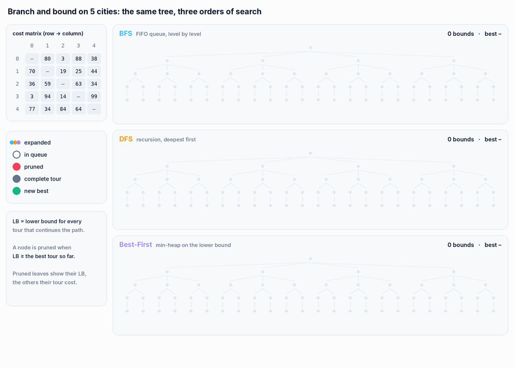
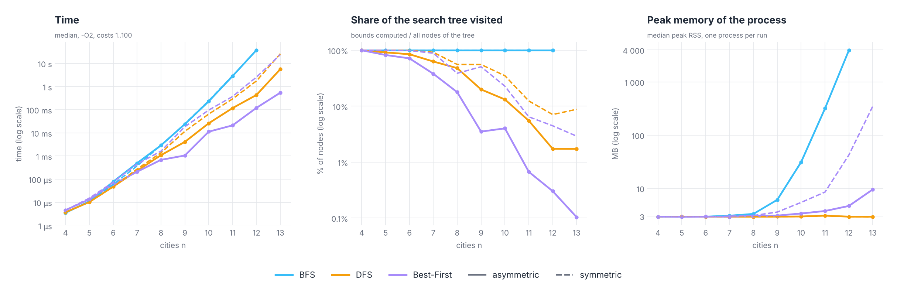

<p align="right">
  <a href="README.md"> <b>English</b></a>
  &nbsp;|&nbsp;
  <a href="README.pl.md"> Polski</a>
</p>

<a href="#see-it-in-action">
  <picture>
    <source media="(prefers-color-scheme: dark)" srcset="docs/banner-en-dark.svg" />
    <source media="(prefers-color-scheme: light)" srcset="docs/banner-en-light.svg" />
    
  </picture>
</a>

<p align="center">
  
  
  
  
  
</p>

<p align="center">
  <a href="#see-it-in-action"><b>Demo</b></a> &nbsp;·&nbsp;
  <a href="#how-it-works"><b>How it works</b></a> &nbsp;·&nbsp;
  <a href="#results"><b>Results</b></a> &nbsp;·&nbsp;
  <a href="#correctness"><b>Correctness</b></a> &nbsp;·&nbsp;
  <a href="#getting-started"><b>Getting started</b></a> &nbsp;·&nbsp;
  <a href="#project-structure"><b>Structure</b></a>
</p>

**ATSP: Branch and Bound** is the second project for the *Design of Efficient Algorithms* course (*Projektowanie Efektywnych Algorytmów*) at Wrocław University of Science and Technology, following [ATSP-Brute-Force-vs-Heuristics](https://github.com/Nurek54/ATSP-Brute-Force-vs-Heuristics). It solves the **asymmetric travelling salesman problem** with **branch and bound** and compares three ways of walking the search tree: **breadth-first (BFS)**, **depth-first (DFS)** and **best-first**.

The program is driven by a config file: it either solves one matrix with the chosen algorithms or runs a simulation on a series of random matrices (asymmetric or symmetric). Every run appends the time, the memory used, the tour and its cost to a CSV file. The queue, the heap and all arrays in the algorithms are written by hand, without STL containers.

## See it in action

<p align="center">
  <picture>
    <source media="(prefers-color-scheme: dark)" srcset="docs/en/tree-dark.gif" />
    <source media="(prefers-color-scheme: light)" srcset="docs/en/tree-light.gif" />
    
  </picture>
</p>

<p align="center"><sub>The whole search tree for 5 cities (65 nodes) and what each variant does with it, event by event. The replay is a Python copy of the C++ code with the same bound, child order and heap, and it matches the program's cost and number of computed bounds on `matrix_6x6`, `matrix_8x8` and 60 random matrices.</sub></p>

## Highlights

<table>
  <tr>
    <td width="25%" align="center"><h3>0.1%</h3><sub>of the search tree visited by<br/>Best-First at 13 cities</sub></td>
    <td width="25%" align="center"><h3>100%</h3><sub>of the tree visited by BFS,<br/>for every number of cities</sub></td>
    <td width="25%" align="center"><h3>3.9 GB</h3><sub>peak memory of BFS at 12 cities;<br/>DFS stays at 3 MB</sub></td>
    <td width="25%" align="center"><h3>0.5%</h3><sub>of asymmetric instances where DFS and<br/>Best-First miss the optimum</sub></td>
  </tr>
</table>

- **One bound, three strategies.** All variants use the same lower bound and the same branching, so the only difference is the order in which nodes are taken: a FIFO queue, recursion, or a min-heap on the bound.
- **Hand-written data structures.** A circular queue that grows by doubling (BFS), a binary min-heap of nodes (Best-First), raw arrays for paths and the matrix.
- **Config instead of a menu.** `config/config.txt` chooses the algorithms, the matrix file or the simulation parameters, including symmetric or asymmetric random matrices.
- **Time and memory to CSV.** Each run appends `algorithm | matrix type | s | ms | ns | memory (KB) | tour | cost` to `BranchAndBound<Variant>Results.csv`.

## How it works

The search starts in city 0. A node is a partial path `0 → … → last`; its children append one more unvisited city, in index order. When the path contains all n cities, the tour is closed back to 0 and compared with the best one so far. A node is pruned when its **lower bound** is not smaller than the best tour found.

The lower bound (`Utilities::calculateLowerBound`) is

```
LB(path) = ⌈ ( cost(path) + Σ over unvisited v of (min_out(v) + min_in(v)) + d[last][0] ) / 2 ⌉
```

where `min_out(v)` and `min_in(v)` are the cheapest edges leaving and entering `v`.

| Variant | Order of nodes | Structure | Memory |
|---|---|---|---|
| BFS | level by level | circular FIFO queue, doubles when full | whole levels of the tree at once |
| DFS | deepest first, children in index order | recursion | one path per level of recursion |
| Best-First | smallest lower bound first | binary min-heap | every open node with its own path |

The full tree for n cities has 1 + (n−1) + (n−1)(n−2) + … + (n−1)! nodes: 65 for 5 cities, 986 410 for 10, 108.5 million for 12.

## Results

Random matrices with costs 1…100, the time reported by the algorithm itself, `-O2`, one core. 30 instances for each n up to 10, 10 for n = 11, 10 to 20 for n = 12 and 3 to 15 for n = 13. BFS was measured up to n = 12 (2 instances: 37 s and 4 GB each). The number of computed bounds and the peak memory come from an instrumented copy of the code, each run in its own process.

<p align="center">
  <picture>
    <source media="(prefers-color-scheme: dark)" srcset="docs/en/results-dark.png" />
    <source media="(prefers-color-scheme: light)" srcset="docs/en/results-light.png" />
    
  </picture>
</p>

**Asymmetric matrices** (median):

| n | BFS | DFS | Best-First | tree visited: DFS | tree visited: Best-First | peak memory: BFS |
|---|---|---|---|---|---|---|
| 10 | 229 ms | 25.8 ms | 11.2 ms | 13.2% | 4.0% | 31 MB |
| 11 | 2.83 s | 117 ms | 21.0 ms | 5.5% | 0.67% | 318 MB |
| 12 | 37.6 s | 433 ms | 120 ms | 1.7% | 0.30% | 3.9 GB |
| 13 | | 5.62 s | 542 ms | 1.7% | 0.10% | |

**Symmetric matrices** (median):

| n | BFS | DFS | Best-First | tree visited: DFS | tree visited: Best-First | peak memory: Best-First |
|---|---|---|---|---|---|---|
| 10 | 243 ms | 64.7 ms | 95.8 ms | 35.0% | 22.7% | 5.4 MB |
| 11 | 2.97 s | 292 ms | 370 ms | 12.4% | 6.4% | 8.5 MB |
| 12 | | 1.75 s | 2.55 s | 7.1% | 4.5% | 42 MB |
| 13 | | 26.0 s | 24.0 s | 8.8% | 2.9% | 350 MB |

What the measurements show:

- **BFS never prunes anything useful.** It visits 100% of the tree for every n. The first complete tour appears only on the last level, after all levels above it have already been expanded, so there is no upper bound to compare with until it is too late. It is a brute force that also keeps whole levels of the tree in memory: 318 MB at 11 cities and 3.9 GB at 12.
- **Best-First is the fastest on asymmetric matrices:** a median of 120 ms at 12 cities against 433 ms for DFS, while BFS needs 35 to 41 s at that size. Best-First computes bounds for only 0.3% of the tree. It pays in memory, because every open node in the heap keeps its own path.
- **DFS needs almost no memory.** Its peak stays at the 3 MB of an empty process for every n, because it only keeps the current path. It finds a complete tour early, which gives it an upper bound for pruning from the start.
- **Symmetric matrices are much harder.** At 12 cities DFS is 4 times and Best-First 21 times slower than on asymmetric ones. Two likely reasons: with d[i][j] = d[j][i] the cheapest edge into a city is the same edge as the cheapest edge out of it, so the bound is looser, and every tour can be walked in both directions at the same cost, so twice as many paths stay competitive. Here DFS beats Best-First up to 12 cities, and Best-First reaches 350 MB at 13.
- **The growth is still exponential.** Each extra city multiplies the BFS time by 12 to 13 and the DFS and Best-First time by 4 to 13, depending on the instance; the bound lowers the base, not the shape.

## Correctness

Every variant was compared with the exact optimum (Held-Karp dynamic programming) on 4 600 asymmetric and 4 600 symmetric random matrices with 5 to 10 cities:

| | Asymmetric | Symmetric |
|---|---|---|
| BFS | ✅ always optimal | ✅ always optimal |
| DFS | ❌ 22 of 4 600 above the optimum (0.5%), at most +51% | ❌ 2 of 4 600 |
| Best-First | ❌ 22 of 4 600 above the optimum (0.5%), at most +25% | ✅ always optimal |

All three give the known optimum on `data/matrix_6x6`, `8x8` and `11x11` (150, 136, 149).

**Why:** a lower bound must never be higher than the cost of a tour that continues the path, otherwise the optimal tour can be pruned. This bound halves the cost of the path already travelled and adds half of the edge `last → 0`, which the tour does not have to use. On `data/matrix_5x5_bound.atsp` the optimum is 115 (0 → 2 → 3 → 1 → 4 → 0), but the path `0 → 2` gets

```
LB = ⌈ (42 + 113 + 93) / 2 ⌉ = 124 > 115
```

where 93 is the edge 2 → 0, which the optimal tour never takes. DFS and Best-First prune `0 → 2` and return 119; BFS gets it right only because it never prunes before the last level. You can run it yourself with `config/bound_example.txt`, see the console session below.

A bound that is always valid: `cost(path) + ⌈(Σ over unvisited v of (min_out(v) + min_in(v)) + min_out(last) + min_in(0)) / 2⌉`. Every remaining edge leaves `last` or an unvisited city and enters an unvisited city or 0, so the remaining part of the tour costs at least that much.

## Getting started

<p align="center">
  
</p>

**CLion:** open the folder and run `atsp_bnb`.

**Command line:**

```bash
cmake -S . -B build -DCMAKE_BUILD_TYPE=Release
cmake --build build
./build/atsp_bnb                              # config/config.txt
./build/atsp_bnb config/bound_example.txt     # any other config
```

Without an argument the program reads `config.txt` from the working directory and, if there is none, `config/config.txt` from the project. Matrix files are looked up in the working directory and then in `data/`. Messages in the program are in Polish.

### Config

```ini
algorithms = BFS, DFS, BEST_FIRST        # any subset
distance_matrix_file = matrix_6x6.atsp   # used when run_simulation = false

run_simulation = false
num_matrices = 100                       # simulation only
matrix_size = 8
max_cost = 100
matrix_type = random                     # random (asymmetric) or symmetric
```

Matrix files have the number of cities on the first line, then the matrix row by row with `-1` on the diagonal. Anything after the matrix is ignored.

### Running the benchmark

```bash
./build/benchmark                # n = 4…12, 10 matrices per n, BFS up to n = 10
./build/benchmark 13 20 11 > results.csv
```

The output is CSV: `algorithm,matrix_type,n,instance,ms,cost,optimum`. The optimum comes from Held-Karp, so every row shows whether branch and bound was right. The default run takes about a minute and a half.

## Project structure

```
.
├── src/
│   ├── main.cpp
│   ├── app/            # ConfigReader, TSPSimulation
│   ├── core/           # TSPInstance, TSPUtilities (tour cost, lower bound), MemoryUsage
│   ├── algorithms/     # BranchAndBoundBFS, BranchAndBoundDFS, BranchAndBoundBestFirst
│   └── io/             # SaveToCSV
├── config/             # config.txt, bound_example.txt
├── data/               # matrix_5x5_bound, matrix_6x6, matrix_8x8, matrix_11x11
├── tools/benchmark.cpp # automatic measurements with Held-Karp as reference
└── docs/               # README visuals (EN / PL, light / dark)
```

<details>
<summary><b>Notes on the code</b></summary>
<br/>

- The memory column in the CSV is the working set of the whole process right after the search (VmRSS on Linux), not the peak, so it says little about the search itself. The peak values above were measured separately.
- BFS would start pruning much earlier with an initial upper bound, for example the cost of a nearest neighbour tour computed before the search.
- `calculateLowerBound` recomputes the cheapest incoming and outgoing edge of every unvisited city for every node, O(n²) per node. These values could be computed once per matrix.
- The `Result` structs free their path in the destructor but have no copy constructor, so they rely on copy elision when returned by value.

</details>

---

<p align="center">
  <sub>Wrocław University of Science and Technology · Design of Efficient Algorithms · Grzegorz Sienkiewicz</sub>
</p>
