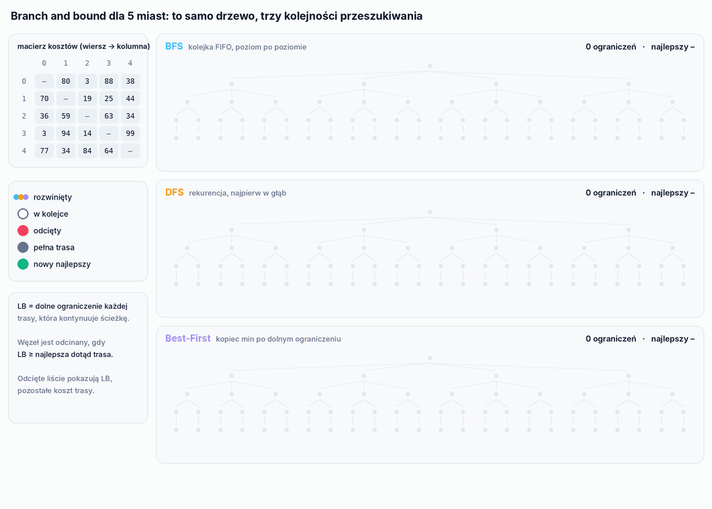
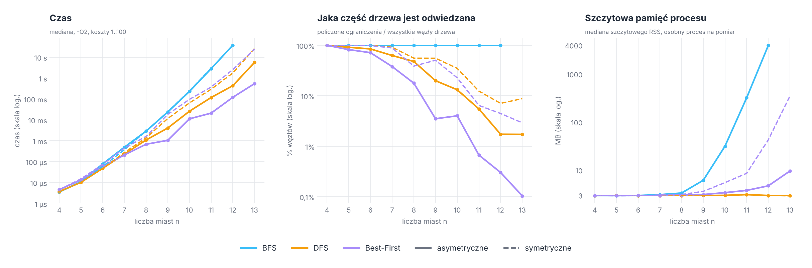

<p align="right">
  <a href="README.md"> English</a>
  &nbsp;|&nbsp;
  <a href="README.pl.md"> <b>Polski</b></a>
</p>

<a href="#zobacz-jak-działa">
  <picture>
    <source media="(prefers-color-scheme: dark)" srcset="docs/banner-pl-dark.svg" />
    <source media="(prefers-color-scheme: light)" srcset="docs/banner-pl-light.svg" />
    
  </picture>
</a>

<p align="center">
  
  
  
  
  
</p>

<p align="center">
  <a href="#zobacz-jak-działa"><b>Demo</b></a> &nbsp;·&nbsp;
  <a href="#jak-to-działa"><b>Jak to działa</b></a> &nbsp;·&nbsp;
  <a href="#wyniki"><b>Wyniki</b></a> &nbsp;·&nbsp;
  <a href="#poprawność"><b>Poprawność</b></a> &nbsp;·&nbsp;
  <a href="#uruchomienie"><b>Uruchomienie</b></a> &nbsp;·&nbsp;
  <a href="#struktura-projektu"><b>Struktura</b></a>
</p>

**ATSP: Branch and Bound** to drugi projekt z kursu *Projektowanie Efektywnych Algorytmów* na Politechnice Wrocławskiej, kontynuacja [ATSP-Brute-Force-vs-Heuristics](https://github.com/Nurek54/ATSP-Brute-Force-vs-Heuristics). Rozwiązuje **asymetryczny problem komiwojażera** metodą **podziału i ograniczeń** (branch and bound) i porównuje trzy sposoby przechodzenia drzewa przeszukiwania: **wszerz (BFS)**, **w głąb (DFS)** i **najpierw najlepszy (Best-First)**.

Program działa na podstawie pliku konfiguracyjnego: rozwiązuje jedną macierz wybranymi algorytmami albo uruchamia symulację na serii losowych macierzy (asymetrycznych lub symetrycznych). Każde uruchomienie dopisuje czas, zużytą pamięć, trasę i jej koszt do pliku CSV. Kolejka, kopiec i wszystkie tablice w algorytmach są napisane od zera, bez kontenerów STL.

## Zobacz, jak działa

<p align="center">
  <picture>
    <source media="(prefers-color-scheme: dark)" srcset="docs/pl/tree-dark.gif" />
    <source media="(prefers-color-scheme: light)" srcset="docs/pl/tree-light.gif" />
    
  </picture>
</p>

<p align="center"><sub>Całe drzewo przeszukiwania dla 5 miast (65 węzłów) i to, co robi z nim każdy wariant, zdarzenie po zdarzeniu. Animacja to kopia kodu C++ w Pythonie z tym samym ograniczeniem, kolejnością dzieci i kopcem; zgadza się z programem co do kosztu i liczby policzonych ograniczeń na <code>matrix_6x6</code>, <code>matrix_8x8</code> i 60 losowych macierzach.</sub></p>

## W skrócie

<table>
  <tr>
    <td width="25%" align="center"><h3>0,1%</h3><sub>drzewa przeszukiwania odwiedza<br/>Best-First dla 13 miast</sub></td>
    <td width="25%" align="center"><h3>100%</h3><sub>drzewa odwiedza BFS<br/>dla każdej liczby miast</sub></td>
    <td width="25%" align="center"><h3>3,9 GB</h3><sub>szczytowej pamięci BFS dla 12 miast;<br/>DFS zostaje przy 3 MB</sub></td>
    <td width="25%" align="center"><h3>0,5%</h3><sub>instancji asymetrycznych, w których DFS<br/>i Best-First nie trafiają w optimum</sub></td>
  </tr>
</table>

- **Jedno ograniczenie, trzy strategie.** Wszystkie warianty używają tego samego dolnego ograniczenia i tego samego podziału, więc różnią się tylko kolejnością brania węzłów: kolejka FIFO, rekurencja albo kopiec min po ograniczeniu.
- **Własne struktury danych.** Kolejka cykliczna powiększana przez podwajanie (BFS), binarny kopiec min węzłów (Best-First), zwykłe tablice na ścieżki i macierz.
- **Konfiguracja zamiast menu.** `config/config.txt` wybiera algorytmy, plik z macierzą albo parametry symulacji, łącznie z losowymi macierzami symetrycznymi lub asymetrycznymi.
- **Czas i pamięć do CSV.** Każde uruchomienie dopisuje `algorytm | typ macierzy | s | ms | ns | pamięć (KB) | trasa | koszt` do `BranchAndBound<Wariant>Results.csv`.

## Jak to działa

Przeszukiwanie zaczyna się w mieście 0. Węzeł to częściowa ścieżka `0 → … → ostatnie`; jego dzieci dokładają jedno nieodwiedzone miasto, w kolejności indeksów. Gdy ścieżka zawiera wszystkie n miast, trasa jest zamykana z powrotem do 0 i porównywana z najlepszą dotąd. Węzeł jest odcinany, gdy jego **dolne ograniczenie** nie jest mniejsze od najlepszej znalezionej trasy.

Dolne ograniczenie (`Utilities::calculateLowerBound`) to

```
LB(ścieżka) = ⌈ ( koszt(ścieżki) + Σ po nieodwiedzonych v (min_out(v) + min_in(v)) + d[ostatnie][0] ) / 2 ⌉
```

gdzie `min_out(v)` i `min_in(v)` to najtańsze krawędzie wychodzące z `v` i wchodzące do `v`.

| Wariant | Kolejność węzłów | Struktura | Pamięć |
|---|---|---|---|
| BFS | poziom po poziomie | cykliczna kolejka FIFO, podwajana po zapełnieniu | całe poziomy drzewa naraz |
| DFS | najpierw najgłębsze, dzieci w kolejności indeksów | rekurencja | jedna ścieżka na poziom rekurencji |
| Best-First | najpierw najmniejsze dolne ograniczenie | binarny kopiec min | każdy otwarty węzeł z własną ścieżką |

Pełne drzewo dla n miast ma 1 + (n−1) + (n−1)(n−2) + … + (n−1)! węzłów: 65 dla 5 miast, 986 410 dla 10 i 108,5 miliona dla 12.

## Wyniki

Losowe macierze z kosztami 1…100, czas raportowany przez sam algorytm, `-O2`, jeden rdzeń. 30 instancji dla każdego n do 10, 10 dla n = 11, od 10 do 20 dla n = 12 i od 3 do 15 dla n = 13. BFS był mierzony do n = 12 (2 instancje: po 37 s i 4 GB). Liczba policzonych ograniczeń i szczytowa pamięć pochodzą z instrumentowanej kopii kodu, każdy pomiar w osobnym procesie.

<p align="center">
  <picture>
    <source media="(prefers-color-scheme: dark)" srcset="docs/pl/results-dark.png" />
    <source media="(prefers-color-scheme: light)" srcset="docs/pl/results-light.png" />
    
  </picture>
</p>

**Macierze asymetryczne** (mediana):

| n | BFS | DFS | Best-First | odwiedzone drzewo: DFS | odwiedzone drzewo: Best-First | szczytowa pamięć: BFS |
|---|---|---|---|---|---|---|
| 10 | 229 ms | 25,8 ms | 11,2 ms | 13,2% | 4,0% | 31 MB |
| 11 | 2,83 s | 117 ms | 21,0 ms | 5,5% | 0,67% | 318 MB |
| 12 | 37,6 s | 433 ms | 120 ms | 1,7% | 0,30% | 3,9 GB |
| 13 | | 5,62 s | 542 ms | 1,7% | 0,10% | |

**Macierze symetryczne** (mediana):

| n | BFS | DFS | Best-First | odwiedzone drzewo: DFS | odwiedzone drzewo: Best-First | szczytowa pamięć: Best-First |
|---|---|---|---|---|---|---|
| 10 | 243 ms | 64,7 ms | 95,8 ms | 35,0% | 22,7% | 5,4 MB |
| 11 | 2,97 s | 292 ms | 370 ms | 12,4% | 6,4% | 8,5 MB |
| 12 | | 1,75 s | 2,55 s | 7,1% | 4,5% | 42 MB |
| 13 | | 26,0 s | 24,0 s | 8,8% | 2,9% | 350 MB |

Co pokazują pomiary:

- **BFS nie odcina niczego, co by się liczyło.** Odwiedza 100% drzewa dla każdego n. Pierwsza pełna trasa pojawia się dopiero na ostatnim poziomie, gdy wszystkie wyższe poziomy są już rozwinięte, więc do tego czasu nie ma górnego ograniczenia, z którym można by porównywać. To przegląd zupełny, który dodatkowo trzyma w pamięci całe poziomy drzewa: 318 MB dla 11 miast i 3,9 GB dla 12.
- **Best-First jest najszybszy na macierzach asymetrycznych:** mediana 120 ms dla 12 miast wobec 433 ms DFS, a BFS potrzebuje przy tym rozmiarze od 35 do 41 s. Best-First liczy ograniczenia tylko dla 0,3% drzewa. Płaci za to pamięcią, bo każdy otwarty węzeł w kopcu trzyma własną ścieżkę.
- **DFS prawie nie potrzebuje pamięci.** Jego szczyt zostaje przy 3 MB pustego procesu dla każdego n, bo trzyma tylko bieżącą ścieżkę. Pełną trasę znajduje wcześnie, więc od początku ma górne ograniczenie do odcinania.
- **Macierze symetryczne są dużo trudniejsze.** Dla 12 miast DFS jest 4 razy, a Best-First 21 razy wolniejszy niż na asymetrycznych. Dwa prawdopodobne powody: przy d[i][j] = d[j][i] najtańsza krawędź wchodząca do miasta jest tą samą krawędzią co najtańsza wychodząca, więc ograniczenie jest luźniejsze, a każdą trasę da się przejść w obie strony z tym samym kosztem, więc dwa razy więcej ścieżek pozostaje w grze. Tutaj DFS wygrywa z Best-First do 12 miast, a Best-First dla 13 miast dochodzi do 350 MB.
- **Wzrost nadal jest wykładniczy.** Każde kolejne miasto mnoży czas BFS przez 12 do 13, a DFS i Best-First przez 4 do 13, zależnie od instancji; ograniczenie obniża podstawę, a nie zmienia kształtu.

## Poprawność

Każdy wariant porównałem z dokładnym optimum (programowanie dynamiczne Held-Karp) na 4 600 asymetrycznych i 4 600 symetrycznych losowych macierzach od 5 do 10 miast:

| | Asymetryczne | Symetryczne |
|---|---|---|
| BFS | ✅ zawsze optymalny | ✅ zawsze optymalny |
| DFS | ❌ 22 z 4 600 powyżej optimum (0,5%), najwyżej +51% | ❌ 2 z 4 600 |
| Best-First | ❌ 22 z 4 600 powyżej optimum (0,5%), najwyżej +25% | ✅ zawsze optymalny |

Wszystkie trzy dają znane optimum na `data/matrix_6x6`, `8x8` i `11x11` (150, 136, 149).

**Dlaczego:** dolne ograniczenie nie może być większe od kosztu żadnej trasy, która kontynuuje ścieżkę, inaczej optymalna trasa może zostać odcięta. To ograniczenie dzieli przez 2 koszt już przebytej ścieżki i dodaje połowę krawędzi `ostatnie → 0`, której trasa wcale nie musi użyć. Na `data/matrix_5x5_bound.atsp` optimum to 115 (0 → 2 → 3 → 1 → 4 → 0), ale ścieżka `0 → 2` dostaje

```
LB = ⌈ (42 + 113 + 93) / 2 ⌉ = 124 > 115
```

gdzie 93 to krawędź 2 → 0, której optymalna trasa nigdy nie bierze. DFS i Best-First odcinają `0 → 2` i zwracają 119; BFS trafia tylko dlatego, że przed ostatnim poziomem niczego nie odcina. Można to sprawdzić samemu z `config/bound_example.txt`, patrz sesja w konsoli poniżej.

Ograniczenie, które jest zawsze poprawne: `koszt(ścieżki) + ⌈(Σ po nieodwiedzonych v (min_out(v) + min_in(v)) + min_out(ostatnie) + min_in(0)) / 2⌉`. Każda pozostała krawędź wychodzi z `ostatnie` albo z nieodwiedzonego miasta i wchodzi do nieodwiedzonego miasta albo do 0, więc reszta trasy kosztuje co najmniej tyle.

## Uruchomienie

<p align="center">
  
</p>

**CLion:** otwórz folder i uruchom `atsp_bnb`.

**Wiersz poleceń:**

```bash
cmake -S . -B build -DCMAKE_BUILD_TYPE=Release
cmake --build build
./build/atsp_bnb                              # config/config.txt
./build/atsp_bnb config/bound_example.txt     # dowolny inny plik konfiguracyjny
```

Bez argumentu program czyta `config.txt` z katalogu roboczego, a jeśli go tam nie ma, `config/config.txt` z projektu. Pliki z macierzą są szukane w katalogu roboczym, a potem w `data/`.

### Konfiguracja

```ini
algorithms = BFS, DFS, BEST_FIRST        # dowolny podzbiór
distance_matrix_file = matrix_6x6.atsp   # gdy run_simulation = false

run_simulation = false
num_matrices = 100                       # tylko symulacja
matrix_size = 8
max_cost = 100
matrix_type = random                     # random (asymetryczne) albo symmetric
```

Pliki z macierzą mają w pierwszej linii liczbę miast, a potem macierz wiersz po wierszu z `-1` na przekątnej. Wszystko po macierzy jest pomijane.

### Benchmark

```bash
./build/benchmark                # n = 4…12, 10 macierzy na n, BFS do n = 10
./build/benchmark 13 20 11 > results.csv
```

Wynik to CSV: `algorithm,matrix_type,n,instance,ms,cost,optimum`. Optimum liczy Held-Karp, więc każdy wiersz pokazuje, czy branch and bound trafił. Domyślny pomiar trwa około półtorej minuty.

## Struktura projektu

```
.
├── src/
│   ├── main.cpp
│   ├── app/            # ConfigReader, TSPSimulation
│   ├── core/           # TSPInstance, TSPUtilities (koszt trasy, dolne ograniczenie), MemoryUsage
│   ├── algorithms/     # BranchAndBoundBFS, BranchAndBoundDFS, BranchAndBoundBestFirst
│   └── io/             # SaveToCSV
├── config/             # config.txt, bound_example.txt
├── data/               # matrix_5x5_bound, matrix_6x6, matrix_8x8, matrix_11x11
├── tools/benchmark.cpp # automatyczne pomiary z Held-Karp jako wzorcem
└── docs/               # grafiki do README (EN / PL, jasne / ciemne)
```

<details>
<summary><b>Uwagi do kodu</b></summary>
<br/>

- Kolumna z pamięcią w CSV to working set całego procesu zaraz po przeszukiwaniu (VmRSS na Linuksie), a nie szczyt, więc niewiele mówi o samym przeszukiwaniu. Wartości szczytowe powyżej zmierzyłem osobno.
- BFS zacząłby odcinać dużo wcześniej z początkowym górnym ograniczeniem, na przykład kosztem trasy najbliższego sąsiada policzonym przed przeszukiwaniem.
- `calculateLowerBound` dla każdego węzła liczy od nowa najtańszą krawędź wchodzącą i wychodzącą każdego nieodwiedzonego miasta, O(n²) na węzeł. Te wartości można policzyć raz dla macierzy.
- Struktury `Result` zwalniają ścieżkę w destruktorze, ale nie mają konstruktora kopiującego, więc przy zwracaniu przez wartość polegają na pominięciu kopii (copy elision).

</details>

---

<p align="center">
  <sub>Politechnika Wrocławska · Projektowanie Efektywnych Algorytmów · Grzegorz Sienkiewicz</sub>
</p>
